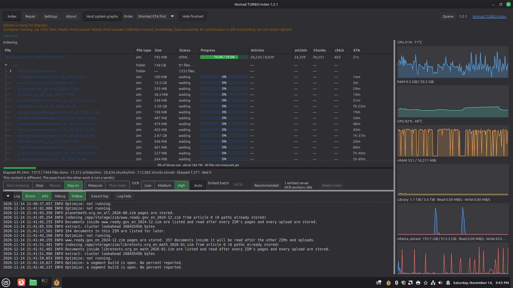

# NOMAD Turbo

[Nomad TURBO Index](https://github.com/Vibe-Dragon/Nomad-TURBO-Index) speeds up a stock [Project NOMAD](https://github.com/Crosstalk-Solutions/project-nomad) knowledge base from outside the admin container. It detects the machine it is on and sizes one embed call from that hardware. This copy was tested with Project NOMAD 1.35.2.

Turbo does not edit compose and does not copy itself into the admin image. It writes vectors into the same Qdrant collection NOMAD searches. Back up what you care about before you click **Start indexing** or **Delete index**. The [FAQ](docs/faq.md) covers Delete index, Manual and Always, and the other questions.

## Install

The current package is [`nomad-turbo_1.3.3_all.deb`](nomad-turbo_1.3.3_all.deb) at the top of this repository. Older packages are in [`old-versions/`](old-versions/).

Open the `.deb` from the file manager and install it. That does not start indexing and does not delete stored points, ZIM files, or uploads.

The package depends on Python 3 and GTK. It does not depend on a specific graphics card. After install, **Nomad TURBO Index** runs `/usr/bin/nomad-turbo`. Docker has to be usable by your user, and NOMAD has to be running. Turbo finds that install when it starts.

To build the package from this tree, run `packaging/build-deb.sh`. It writes `dist/nomad-turbo_<version>_all.deb` and does not install the package.

## What is different

Checked against Project NOMAD 1.35.2. The [comparison](docs/vs-stock.md) is the detailed breakdown.

- Turbo runs outside the admin container and uses its own embed server. Stock still queues `file-embeddings` jobs of 8 chunks.
- A long page is kept. Turbo splits a chunk that would be too long for the embedder. Stock truncates a chunk that estimates over 1600 tokens.
- Stock 1.35.2 seeks the next ZIM batch with a dirent cursor. Turbo keeps one reader open, stores the path and the dirent, and checks the path after the seek.
- Turbo reads upload PDFs and pictures itself. A PDF page is drawn when it has no text, or when **OCR every PDF** is on. Stock reads uploads inside the admin container, and a ZIM walk there is still HTML only.
- Turbo pauses only file embedding and puts the ingest policy back to the value found at Start.

## More

- [FAQ](docs/faq.md)
- [How Turbo indexing differs from stock NOMAD](docs/vs-stock.md)
- [Window](docs/window.md)
- [Resource spikes](docs/spikes.md)
- [Log](docs/log.md)
- [Repair](docs/repair.md)
- [Commands](docs/commands.md)
- [What comes next](docs/roadmap.md)
- [Stock contract](docs/stock-contract.md)
- [Upstream pull requests](docs/upstream-prs.md)
- [Changelog](CHANGELOG.md)

It does not upgrade NOMAD, edit compose, or copy files into the admin container. The license is MIT. See `LICENSE`.
